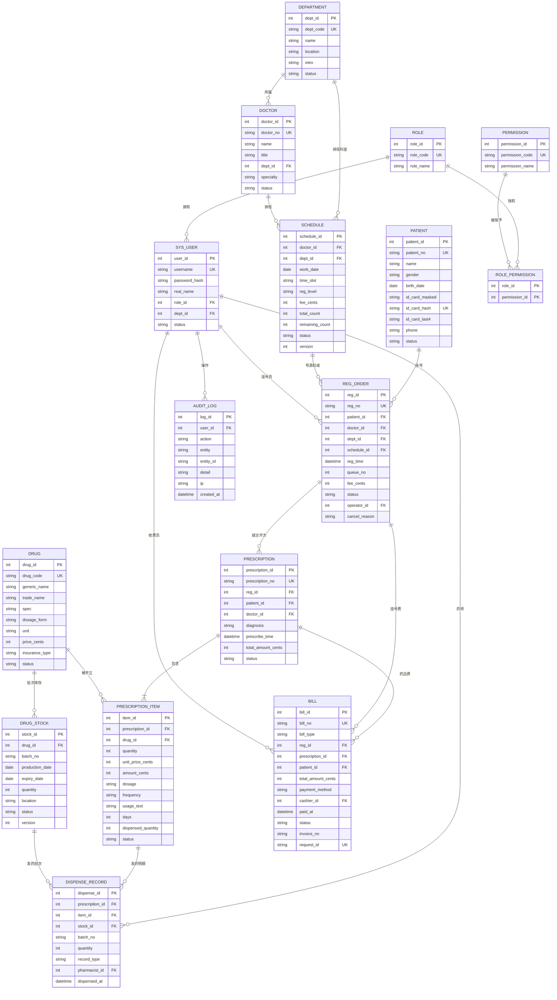

# A 门诊线 · ER 图、数据字典与 10 实体核对

> 课程：医院信息系统实验 · 第 4 课任务一
> 选题：A 门诊线
> 组号：__________　组员：__________ / __________ / __________
> 配套文件：`04_schema.sql`（SQLite 建表脚本）

---

## 一、ER 图（Mermaid）



### 关系说明

| 关系 | 基数 | 说明 |
|---|---|---|
| 患者—挂号单 | 1:N | 一个患者可多次挂号；挂号单必须属于一个患者 |
| 科室—医生 | 1:N | 一个科室多名医生；医生必须属于一个科室 |
| 医生—排班号源 | 1:N | 一名医生多天/多时段排班 |
| 排班号源—挂号单 | 1:N | 一个号源可被多名患者挂；挂号单必须指向一个号源（号源即库存） |
| 挂号单—处方 | 1:N | 一次就诊可开多张处方（如西药、中成药分开） |
| 处方—处方明细 | 1:N | 一张处方至少一条明细 |
| 药品—处方明细 | 1:N | 一个药品可出现在多条明细 |
| 药品—药品库存 | 1:N | 一个药品多个批次；库存挂在药品上，不挂在处方上 |
| 处方—收费单 | 1:N | MVP 一张处方对应一张收费单；退费更新原单状态；保留 1:N 以支持未来补费/多次退费 |
| 挂号单—收费单 | 1:N | 挂号费收费单；退号时原单置已退费；保留 1:N 以支持未来退费单 |
| 处方明细—发药记录 | 1:N | 一条明细可能跨多个批次发药 |
| 药品库存—发药记录 | 1:N | 一个批次可被多次发药；退药也写记录 |
| 用户—挂号单/收费单/发药记录 | 1:N | 操作人留痕；收费员与药师分离 |
| 角色—用户 | 1:N | MVP 一个用户一个角色；后续可扩展多角色 |
| 角色—权限 | M:N | 通过 `role_permissions` 关联 |

> 注意：Mermaid 不能表达“收费单的 `reg_id` 与 `prescription_id` 二选一”这种 XOR 约束，已在 `04_schema.sql` 用 `CHECK` 表达。ER 图看关系，SQL 看约束，两者要对照着审查。

---

## 二、10 个核心实体核对表

> 这张表是审查 AI 建表 SQL 的对照表。结论列由组内架构师人工填写；AI 初稿只能作为“待核对”。

| 序号 | 实体 | 表名 | 核心字段（必须存在） | AI 易漏点 / 人工核对重点 | 核对结论 |
|---|---|---|---|---|---|
| 1 | 患者 | `patients` | patient_id、patient_no、name、gender、birth_date、id_card_masked、id_card_hash、id_card_last4、phone、status | 只存脱敏串不够，还要哈希查重；不能存明文；手机号也要脱敏展示 | 待人工核对 |
| 2 | 科室 | `departments` | dept_id、dept_code、name、location、intro、status | 位置、简介、状态容易漏；停用科室不能新挂号 | 待人工核对 |
| 3 | 医生 | `doctors` | doctor_id、doctor_no、name、title、dept_id、specialty、status | 职称、专长、状态容易漏；医生停诊与排班停诊要区分 | 待人工核对 |
| 4 | 排班号源 | `schedules` | schedule_id、doctor_id、dept_id、work_date、time_slot、reg_level、fee_cents、total_count、remaining_count、status、version | **这是挂号的“库存”**：必须有总量、剩余量、时段、号别、挂号费、状态；同一医生同日同时段同号别唯一；剩余量不能为负 | 待人工核对 |
| 5 | 挂号单 | `reg_orders` | reg_id、reg_no、patient_id、doctor_id、dept_id、schedule_id、reg_time、queue_no、fee_cents、status、operator_id、cancel_reason | schedule_id、queue_no、fee_cents、operator_id、status 容易漏；排队号在同一号源内唯一 | 待人工核对 |
| 6 | 处方 | `prescriptions` | prescription_id、prescription_no、reg_id、patient_id、doctor_id、diagnosis、prescribe_time、total_amount_cents、status | 诊断、开方时间、总额、状态容易漏；状态机必须能区分草稿/待收费/已收费/已发药/退费/退药/作废 | 待人工核对 |
| 7 | 处方明细 | `prescription_items` | item_id、prescription_id、drug_id、quantity、unit_price_cents、amount_cents、dosage、frequency、usage_text、days、dispensed_quantity、status | 单价快照、金额、用法、频次、天数、已发数量、状态最容易漏；金额必须=数量×单价 | 待人工核对 |
| 8 | 药品 | `drugs` | drug_id、drug_code、generic_name、trade_name、spec、dosage_form、unit、price_cents、insurance_type、status | 商品名、规格、剂型、单位、医保类别、状态容易漏；停用药品不能开方 | 待人工核对 |
| 9 | 药品库存 | `drug_stocks` | stock_id、drug_id、batch_no、production_date、expiry_date、quantity、location、status、version | **批次、效期、状态、数量**最容易漏；同一药品同一批次唯一；过期/冻结/召回不可发药；数量不能为负 | 待人工核对 |
| 10 | 收费单 | `bills` | bill_id、bill_no、bill_type、reg_id、prescription_id、patient_id、total_amount_cents、payment_method、cashier_id、paid_at、status、invoice_no、request_id | 收费员、时间、支付方式、状态、退费关联、幂等 request_id 容易漏；挂号费/药品费二选一关联；金额用分 | 待人工核对 |

---

## 三、数据字典（核心表）

### 3.1 患者 `patients`

| 字段 | 类型 | 约束/说明 | 易漏 |
|---|---|---|---|
| patient_id | INTEGER | 主键，自增 | |
| patient_no | TEXT | 唯一，患者编号（如 P000001） | |
| name | TEXT | 必填 | |
| gender | TEXT | 必填，CHECK（男/女/未知） | |
| birth_date | TEXT | 必填，`YYYY-MM-DD`；由身份证解析或手工录入 | |
| id_card_masked | TEXT | 必填，18 位，前 6 + 8 星号 + 后 4 | 是 |
| id_card_hash | TEXT | 必填，唯一；SHA-256(pepper + 规范化身份证号) | 是 |
| id_card_last4 | TEXT | 必填，后 4 位；与 masked 后 4 位一致 | 是 |
| phone | TEXT | 可空，11 位手机号；展示时脱敏 | |
| status | TEXT | 正常/停用 | 是 |
| created_at | TEXT | 创建时间 | |

### 3.2 科室 `departments`

| 字段 | 类型 | 约束/说明 | 易漏 |
|---|---|---|---|
| dept_id | INTEGER | 主键 | |
| dept_code | TEXT | 唯一，科室编码 | |
| name | TEXT | 必填，科室名称 | |
| location | TEXT | 位置（如门诊楼 2 层） | 是 |
| intro | TEXT | 简介 | 是 |
| status | TEXT | 启用/停用 | 是 |
| created_at | TEXT | 创建时间 | |

### 3.3 医生 `doctors`

| 字段 | 类型 | 约束/说明 | 易漏 |
|---|---|---|---|
| doctor_id | INTEGER | 主键 | |
| doctor_no | TEXT | 唯一，医生工号 | |
| name | TEXT | 必填 | |
| title | TEXT | 主任医师/副主任医师/主治医师/住院医师 | 是 |
| dept_id | INTEGER | 外键 → departments | |
| specialty | TEXT | 专长 | 是 |
| status | TEXT | 在岗/停诊/离岗 | 是 |
| created_at | TEXT | 创建时间 | |

### 3.4 排班号源 `schedules`（挂号的“库存”）

| 字段 | 类型 | 约束/说明 | 易漏 |
|---|---|---|---|
| schedule_id | INTEGER | 主键 | |
| doctor_id | INTEGER | 外键 → doctors | |
| dept_id | INTEGER | 外键 → departments；排班科室快照 | 是 |
| work_date | TEXT | 必填，`YYYY-MM-DD` | |
| time_slot | TEXT | 上午/下午/夜间 | 是 |
| reg_level | TEXT | 普通号/专家号/急诊号 | 是 |
| fee_cents | INTEGER | 挂号费，单位分，≥0 | 是 |
| total_count | INTEGER | 号源总量，>0 | 是 |
| remaining_count | INTEGER | 剩余量，0 ≤ remaining ≤ total | **是** |
| status | TEXT | 正常/停诊/满号 | **是** |
| version | INTEGER | 乐观锁版本号，每次扣减 +1 | 是 |
| created_at / updated_at | TEXT | 时间戳 | |
| 唯一约束 | — | (doctor_id, work_date, time_slot, reg_level) 唯一 | **是** |

### 3.5 挂号单 `reg_orders`

| 字段 | 类型 | 约束/说明 | 易漏 |
|---|---|---|---|
| reg_id | INTEGER | 主键 | |
| reg_no | TEXT | 唯一，挂号单号 | |
| patient_id | INTEGER | 外键 → patients | |
| doctor_id | INTEGER | 外键 → doctors；冗余便于查询 | |
| dept_id | INTEGER | 外键 → departments；挂号科室快照 | 是 |
| schedule_id | INTEGER | 外键 → schedules；关联号源 | **是** |
| reg_time | TEXT | 挂号时间 | |
| queue_no | INTEGER | 排队号，>0；同一 schedule 内唯一 | **是** |
| fee_cents | INTEGER | 挂号费快照，≥0 | 是 |
| status | TEXT | 候诊/就诊/完成/退号/取消 | **是** |
| operator_id | INTEGER | 外键 → sys_users，挂号员 | **是** |
| cancel_reason | TEXT | 退号/取消原因 | 是 |
| created_at | TEXT | 创建时间 | |

### 3.6 处方 `prescriptions`

| 字段 | 类型 | 约束/说明 | 易漏 |
|---|---|---|---|
| prescription_id | INTEGER | 主键 | |
| prescription_no | TEXT | 唯一，处方号 | |
| reg_id | INTEGER | 外键 → reg_orders | |
| patient_id | INTEGER | 外键 → patients | |
| doctor_id | INTEGER | 外键 → doctors | |
| diagnosis | TEXT | 诊断，必填 | 是 |
| prescribe_time | TEXT | 开方时间 | 是 |
| total_amount_cents | INTEGER | 处方总额，单位分，≥0；由明细汇总 | 是 |
| status | TEXT | 草稿/待收费/已收费/已发药/已退费/已退药/作废 | **是** |
| created_at | TEXT | 创建时间 | |

### 3.7 处方明细 `prescription_items`

| 字段 | 类型 | 约束/说明 | 易漏 |
|---|---|---|---|
| item_id | INTEGER | 主键 | |
| prescription_id | INTEGER | 外键 → prescriptions，级联删除 | |
| drug_id | INTEGER | 外键 → drugs | |
| quantity | INTEGER | 数量，>0 | |
| unit_price_cents | INTEGER | 开方时单价快照，≥0 | **是** |
| amount_cents | INTEGER | 金额 = quantity × unit_price_cents | **是** |
| dosage | TEXT | 单次剂量（如 0.5g） | **是** |
| frequency | TEXT | 频次（如 tid、bid） | **是** |
| usage_text | TEXT | 用法（口服/外用/静滴） | **是** |
| days | INTEGER | 天数，>0 | **是** |
| dispensed_quantity | INTEGER | 已发数量，0 ≤ dispensed ≤ quantity | **是** |
| status | TEXT | 待发药/已发药/已退药/作废 | **是** |
| created_at | TEXT | 创建时间 | |

### 3.8 药品 `drugs`

| 字段 | 类型 | 约束/说明 | 易漏 |
|---|---|---|---|
| drug_id | INTEGER | 主键 | |
| drug_code | TEXT | 唯一，药品编码 | |
| generic_name | TEXT | 通用名，必填 | |
| trade_name | TEXT | 商品名 | 是 |
| spec | TEXT | 规格（如 0.25g×24 片） | 是 |
| dosage_form | TEXT | 剂型（片剂/胶囊/注射液） | 是 |
| unit | TEXT | 单位（盒/瓶/支） | 是 |
| price_cents | INTEGER | 单价，单位分，≥0 | 是 |
| insurance_type | TEXT | 甲类/乙类/自费/丙类 | 是 |
| status | TEXT | 启用/停用 | 是 |
| created_at | TEXT | 创建时间 | |

### 3.9 药品库存 `drug_stocks`

| 字段 | 类型 | 约束/说明 | 易漏 |
|---|---|---|---|
| stock_id | INTEGER | 主键 | |
| drug_id | INTEGER | 外键 → drugs | |
| batch_no | TEXT | 批次号，必填 | **是** |
| production_date | TEXT | 生产日期，可空 | 是 |
| expiry_date | TEXT | 效期，必填，`YYYY-MM-DD` | **是** |
| quantity | INTEGER | 库存数量，≥0 | |
| location | TEXT | 货位/库位 | 是 |
| status | TEXT | 正常/冻结/过期/召回 | **是** |
| version | INTEGER | 乐观锁版本号 | 是 |
| created_at / updated_at | TEXT | 时间戳 | |
| 唯一约束 | — | (drug_id, batch_no) 唯一 | **是** |

### 3.10 收费单 `bills`

| 字段 | 类型 | 约束/说明 | 易漏 |
|---|---|---|---|
| bill_id | INTEGER | 主键 | |
| bill_no | TEXT | 唯一，收费单号 | |
| bill_type | TEXT | 挂号费/药品费 | **是** |
| reg_id | INTEGER | 外键 → reg_orders；挂号费时必填 | **是** |
| prescription_id | INTEGER | 外键 → prescriptions；药品费时必填 | **是** |
| patient_id | INTEGER | 外键 → patients | |
| total_amount_cents | INTEGER | 金额，单位分，≥0 | |
| payment_method | TEXT | 现金/微信/支付宝/银行卡 | 是 |
| cashier_id | INTEGER | 外键 → sys_users，收费员 | **是** |
| paid_at | TEXT | 收费时间 | **是** |
| status | TEXT | 已收费/已退费；退费与退药都要同步置为已退费 | **是** |
| invoice_no | TEXT | 发票号，可空；MVP 不接发票系统 | 是 |
| request_id | TEXT | 唯一，幂等键；防重复收费 | **是** |
| created_at | TEXT | 创建时间 | |

> XOR 约束：`bill_type=挂号费` 时只能有 `reg_id`；`bill_type=药品费` 时只能有 `prescription_id`。已在 `04_schema.sql` 用 `CHECK` 实现。

### 3.11 支撑表（不属于 10 个核心实体，但必须有）

| 表 | 作用 | 关键字段 |
|---|---|---|
| `dispense_records` | 发药/退药追溯 | prescription_id、item_id、stock_id、batch_no、quantity、record_type（发药/退药）、pharmacist_id、dispensed_at |
| `sys_users` | 登录用户 | username、password_hash、real_name、role_id、dept_id、status |
| `roles` | 角色 | role_code、role_name |
| `permissions` | 权限点 | permission_code、permission_name |
| `role_permissions` | 角色-权限关联 | role_id、permission_id |
| `audit_logs` | 审计日志 | user_id、action、entity、entity_id、detail、ip、created_at |

---

## 四、身份证脱敏规则（人工定稿）

### 4.1 展示规则

- 统一格式：**前 6 位 + 8 个星号 + 后 4 位**，总长度 18。
- 示例：`110101********1234`。
- 列表、详情、打印、导出、日志、错误提示一律使用脱敏串；禁止在任何页面显示完整身份证号。
- 手机号展示：`138****5678`（前 3 + 4 星号 + 后 4）。

### 4.2 存储规则（MVP）

| 字段 | 内容 | 说明 |
|---|---|---|
| `id_card_masked` | `110101********1234` | 用于展示 |
| `id_card_hash` | `SHA-256(pepper + 规范化身份证号)` | 用于唯一查重；不可逆 |
| `id_card_last4` | `1234` | 用于人工辅助核对 |

- **不存明文**；`pepper` 放在环境变量/部署密钥中，不写进代码仓库、不写进数据库。
- `id_card_hash` 建唯一索引；重复身份证直接命中已有患者。
- 查询只能按哈希精确匹配，禁止对明文做 `LIKE` 模糊查询（因为库里没有明文）。

### 4.3 真实项目升级方案

- 增加 `id_card_cipher`：AES-256-GCM 加密存储，密钥放 KMS/密钥管理服务，不进数据库。
- 只有授权岗位（如挂号主管）在审计留痕的前提下可解密查看；普通界面仍只显示脱敏串。
- 脱敏串用于展示，哈希用于查重，密文用于确需还原的场景；三者职责分开。

### 4.4 输入校验

1. 去空格、全角转半角、末位 `x` 转大写 `X`。
2. 长度 18；前 17 位为数字，末位为数字或 `X`。
3. 出生日期段（第 7–14 位）必须是合法日期，且不晚于今天。
4. 校验码按 GB 11643-1999 计算：
   - 权重：`[7,9,10,5,8,4,2,1,6,3,7,9,10,5,8,4,2]`
   - 映射：`['1','0','X','9','8','7','6','5','4','3','2']`
   - 计算 `sum(前17位 × 权重) % 11`，查映射得到校验位。
5. 校验通过后立即生成 `masked`、`hash`、`last4`，原始字符串只在内存中短暂存在，不落库、不写日志。
6. 15 位旧身份证：MVP 不支持，提示到窗口人工处理；真实项目先升位再校验。

### 4.5 测试数据

- 演示数据必须使用虚构号码，禁止使用真实患者信息。
- 示例展示串：`110101********1234`（只用于界面/文档示例，不作为真实校验通过样例）。
- 需要“校验通过”的测试号时，由测试脚本生成虚构号码并校验，登记在 `test_data.md`。

### 4.6 安全红线

- 禁止把完整身份证写入：数据库、日志、浏览器 localStorage、URL 参数、错误堆栈、Git 仓库。
- 禁止在答辩 PPT/截图中出现真实身份证；演示库统一用虚构数据。
- 代码评审必查：`id_card`、`身份证` 关键字是否出现明文读写。

---

## 五、事务与并发（开发必须照做）

### 5.1 SQLite 连接设置

```sql
PRAGMA foreign_keys = ON;
PRAGMA journal_mode = WAL;
PRAGMA busy_timeout = 5000;
```

- 所有写事务用 `BEGIN IMMEDIATE`，不要用默认的 deferred，避免“读后写”升级锁失败。
- 捕获 `SQLITE_BUSY` 后有限重试（如 3 次，指数退避）。
- 所有金额用“分”存 INTEGER；禁止 REAL/FLOAT。

### 5.2 挂号：扣号源 + 生成排队号（同一事务）

```sql
BEGIN IMMEDIATE;

UPDATE schedules
SET remaining_count = remaining_count - 1,
    status = CASE WHEN remaining_count - 1 = 0 THEN '满号' ELSE status END,
    version = version + 1,
    updated_at = datetime('now', 'localtime')
WHERE schedule_id = :schedule_id
  AND status = '正常'
  AND remaining_count > 0
  AND work_date >= date('now', 'localtime');

-- 应用层检查 changes() = 1；否则 ROLLBACK

INSERT INTO reg_orders
    (reg_no, patient_id, doctor_id, dept_id, schedule_id,
     queue_no, fee_cents, status, operator_id)
SELECT :reg_no, :patient_id, s.doctor_id, s.dept_id, s.schedule_id,
       (SELECT COALESCE(MAX(queue_no), 0) + 1
          FROM reg_orders WHERE schedule_id = s.schedule_id),
       s.fee_cents, '候诊', :operator_id
FROM schedules s
WHERE s.schedule_id = :schedule_id;

INSERT INTO bills
    (bill_no, bill_type, reg_id, patient_id, total_amount_cents,
     payment_method, cashier_id, request_id)
SELECT :bill_no, '挂号费', r.reg_id, r.patient_id, r.fee_cents,
       :payment_method, :cashier_id, :request_id
FROM reg_orders r
WHERE r.reg_id = last_insert_rowid();

COMMIT;
```

要点：
- 条件更新 `remaining_count > 0` 是防超卖的关键；不能先查再减。
- `BEGIN IMMEDIATE` 让写事务串行化，`queue_no` 的 `MAX+1` 不会并发重复。
- 挂号单与挂号费收费单同一事务；收费单 `request_id` 唯一，重复提交返回已有单。

### 5.3 退号：回滚号源（若已收挂号费则同步退费）

```sql
BEGIN IMMEDIATE;

UPDATE reg_orders
SET status = '退号', cancel_reason = :reason
WHERE reg_id = :reg_id AND status = '候诊';

-- 检查 changes() = 1，否则 ROLLBACK

UPDATE schedules
SET remaining_count = remaining_count + 1,
    status = CASE WHEN status = '满号' THEN '正常' ELSE status END,
    version = version + 1,
    updated_at = datetime('now', 'localtime')
WHERE schedule_id = (SELECT schedule_id FROM reg_orders WHERE reg_id = :reg_id);

UPDATE bills
SET status = '已退费'
WHERE reg_id = :reg_id AND bill_type = '挂号费' AND status = '已收费';

COMMIT;
```

### 5.4 收费：后端重算 + 生成收费单

```sql
BEGIN IMMEDIATE;

-- 1. 校验处方状态为“待收费”
SELECT status, total_amount_cents FROM prescriptions WHERE prescription_id = :pid;

-- 2. 后端按明细重算
SELECT COALESCE(SUM(amount_cents), 0)
FROM prescription_items
WHERE prescription_id = :pid AND status <> '作废';

-- 3. 用重算金额更新处方，状态条件更新防重复收费
UPDATE prescriptions
SET status = '已收费', total_amount_cents = :server_total
WHERE prescription_id = :pid AND status = '待收费';

-- 检查 changes() = 1

INSERT INTO bills
    (bill_no, bill_type, prescription_id, patient_id, total_amount_cents,
     payment_method, cashier_id, request_id)
SELECT :bill_no, '药品费', p.prescription_id, p.patient_id, :server_total,
       :payment_method, :cashier_id, :request_id
FROM prescriptions p
WHERE p.prescription_id = :pid;

COMMIT;
```

要点：
- `:server_total` 必须来自明细汇总，不能来自前端。
- `request_id` 唯一索引兜底：重复点击/网络重试只产生一张收费单。
- 收费单与处方状态同一事务；不能出现“钱收了、处方还没收费”。

### 5.5 发药：FEFO + 扣批次库存 + 发药记录

发药要按“明细 → 可用批次（效期升序）→ 逐批扣减”的顺序执行，全部在一个事务内：

```sql
BEGIN IMMEDIATE;

-- 1. 处方必须是已收费
SELECT status FROM prescriptions WHERE prescription_id = :pid;

-- 2. 对每条明细，按 FEFO 找可用批次
SELECT stock_id, quantity, expiry_date
FROM drug_stocks
WHERE drug_id = :drug_id
  AND status = '正常'
  AND expiry_date >= date('now', 'localtime')
  AND quantity > 0
ORDER BY expiry_date ASC, stock_id ASC;

-- 3. 逐批条件扣减；每次检查 changes() = 1
UPDATE drug_stocks
SET quantity = quantity - :take,
    version = version + 1,
    updated_at = datetime('now', 'localtime')
WHERE stock_id = :stock_id
  AND quantity >= :take
  AND status = '正常'
  AND expiry_date >= date('now', 'localtime');

-- 4. 写发药记录（一条明细可多条记录，对应多个批次）
INSERT INTO dispense_records
    (prescription_id, item_id, stock_id, batch_no, quantity,
     record_type, pharmacist_id, dispensed_at)
VALUES
    (:pid, :item_id, :stock_id, :batch_no, :take,
     '发药', :pharmacist_id, datetime('now', 'localtime'));

-- 5. 更新明细已发数量；全部发完则明细置“已发药”
UPDATE prescription_items
SET dispensed_quantity = dispensed_quantity + :take,
    status = CASE WHEN dispensed_quantity + :take = quantity
                  THEN '已发药' ELSE status END
WHERE item_id = :item_id
  AND dispensed_quantity + :take <= quantity;

-- 6. 所有明细都发完，处方置“已发药”
UPDATE prescriptions
SET status = '已发药'
WHERE prescription_id = :pid
  AND status = '已收费'
  AND NOT EXISTS (
      SELECT 1 FROM prescription_items
      WHERE prescription_id = :pid AND status <> '已发药'
  );

COMMIT;
```

要点：
- 任一批次扣减失败（库存不足/过期/冻结）→ 整个事务 `ROLLBACK`，不能“发一半”。
- 先按效期升序选批次（FEFO），过期批次即使有数量也不能选。
- 发药记录保留批次号、数量、药师、时间，支持追溯。
- 退药只能回补原批次，写一条 `record_type='退药'` 的记录，并减少 `dispensed_quantity`。
- 退药必须整单、未拆封；退药同一事务内把收费单置为“已退费”，处方置为“已退药”；MVP 不支持部分退费。

### 5.6 幂等与唯一约束

| 场景 | 兜底手段 |
|---|---|
| 重复挂号/重复收费 | `bills.request_id` 唯一；前端按钮防抖只是辅助 |
| 重复排队号 | `UNIQUE(schedule_id, queue_no)` |
| 重复排班 | `UNIQUE(doctor_id, work_date, time_slot, reg_level)` |
| 重复批次 | `UNIQUE(drug_id, batch_no)` |
| 超卖 | 条件更新 + `CHECK(remaining_count >= 0)` |
| 库存负数 | 条件更新 + `CHECK(quantity >= 0)` |
| 重复收费单号 | `UNIQUE(bill_no)`、`UNIQUE(request_id)` |

---

## 六、索引建议

```sql
CREATE INDEX idx_schedules_lookup
    ON schedules(work_date, dept_id, doctor_id, status);

CREATE INDEX idx_reg_orders_patient
    ON reg_orders(patient_id, reg_time);

CREATE INDEX idx_reg_orders_schedule_status
    ON reg_orders(schedule_id, status);

CREATE INDEX idx_prescriptions_reg
    ON prescriptions(reg_id);

CREATE INDEX idx_prescriptions_status
    ON prescriptions(status);

CREATE INDEX idx_prescription_items_prescription
    ON prescription_items(prescription_id);

CREATE INDEX idx_drug_stocks_fefo
    ON drug_stocks(drug_id, status, expiry_date);

CREATE INDEX idx_bills_prescription
    ON bills(prescription_id, status);

CREATE INDEX idx_dispense_records_prescription
    ON dispense_records(prescription_id);

CREATE INDEX idx_audit_logs_created
    ON audit_logs(created_at);
```

---

## 七、人工核对结论（签字前逐项打勾）

- [ ] `schedules` 有 `total_count`、`remaining_count`、`time_slot`、`reg_level`、`fee_cents`、`status`、`version`，且 `(doctor_id, work_date, time_slot, reg_level)` 唯一。
- [ ] `drug_stocks` 有 `batch_no`、`production_date`、`expiry_date`、`quantity`、`status`、`version`，且 `(drug_id, batch_no)` 唯一。
- [ ] `reg_orders` 有 `schedule_id`、`queue_no`、`fee_cents`、`status`、`operator_id`，且 `(schedule_id, queue_no)` 唯一。
- [ ] `prescriptions` 有 `diagnosis`、`prescribe_time`、`total_amount_cents`、完整状态机。
- [ ] `prescription_items` 有单价快照、金额、用法、频次、天数、已发数量、状态。
- [ ] `bills` 有 `bill_type`、`reg_id`/`prescription_id` XOR、`cashier_id`、`paid_at`、`status`、`request_id`。
- [ ] `patients` 只存 `id_card_masked` + `id_card_hash` + `id_card_last4`，无明文。
- [ ] 收费、发药、退号、退费、退药都在事务内；失败整单回滚。
- [ ] 金额全部用“分”存 INTEGER，无浮点。
- [ ] 过期/冻结/召回批次不可发药；过期判断在应用层和 SQL 条件里都有。

系统架构师签字：__________　日期：__________
